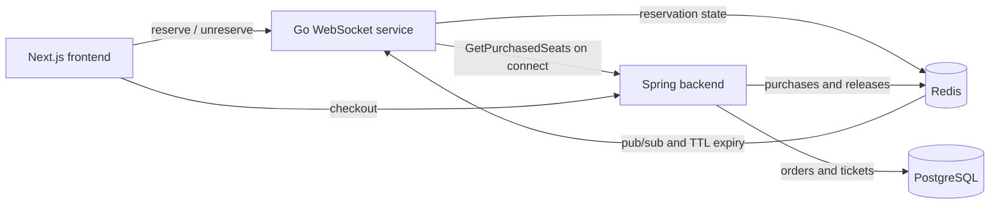

# WebSocket service architecture

The Go service owns short-lived seat reservations and real-time fan-out. Spring
owns users, events, orders, tickets, and the durable purchased-seat state.



## Redis keys

```text
seat:{eventId}:{seatId}               purchased | reserved:{userId}
event_seats:{eventId}                 set of cached seat IDs
user_reservations:{eventId}:{userId}  set of held seat IDs
connections:{eventId}                 active sockets in this Go process
```

Reservation keys expire after 10 minutes. Purchased keys remain while an event
has active clients. When its last client disconnects, purchased keys and the
event index receive a 30-minute cache TTL.

## Connect sequence

1. Validate the WebSocket JWT, origin, user ID, and event UUID.
2. Register the client as pending in the hub. Event messages are now buffered.
3. Increment the event connection counter and cancel any disconnected-cache TTL.
4. Ask Spring for purchased seats and merge them into Redis.
5. Read reservations and purchases from Redis.
6. Queue the snapshot, followed by messages buffered since step 2.
7. Activate the connection for normal fan-out.

This ordering closes the snapshot/register event-loss window. Duplicate
idempotent seat-state frames are possible around the snapshot boundary; missing
newer state is not.

## Purchase and release sequence

Spring commits the database transaction first. Its after-commit hook updates
Redis and publishes comma-separated seat UUIDs:

```text
seatlock:purchases:{eventId}
seatlock:releases:{eventId}
```

Go validates the event and seat UUIDs before broadcasting `purchased_bulk` or
individual `released` messages. Clients cannot submit a `purchased` WebSocket
message. If the after-commit Redis update fails, the next connection repairs the
purchased cache from Spring over gRPC.

## Expiry handling

Redis keyspace notifications report expired reservation keys. Notification
delivery can be delayed, so removal from `event_seats` is guarded by one Lua
script: it removes and broadcasts only when the corresponding seat key is still
absent. A fresh reservation or purchased value is preserved.

## Process lifecycle

The Compose deployment runs one Go WebSocket instance. On startup it scans only
`connections:*`, clears counters left by a crashed predecessor, and schedules
the associated disconnected caches for expiry. This recovery is intentionally
single-instance. Multiple replicas require instance-scoped leases or presence
counters and must not run this startup reset concurrently.

The hub is the sole owner of room membership. Client send channels are never
closed; removal closes an idempotent `done` signal instead. This avoids a
concurrent send/close panic while still terminating slow or disconnected
clients.
